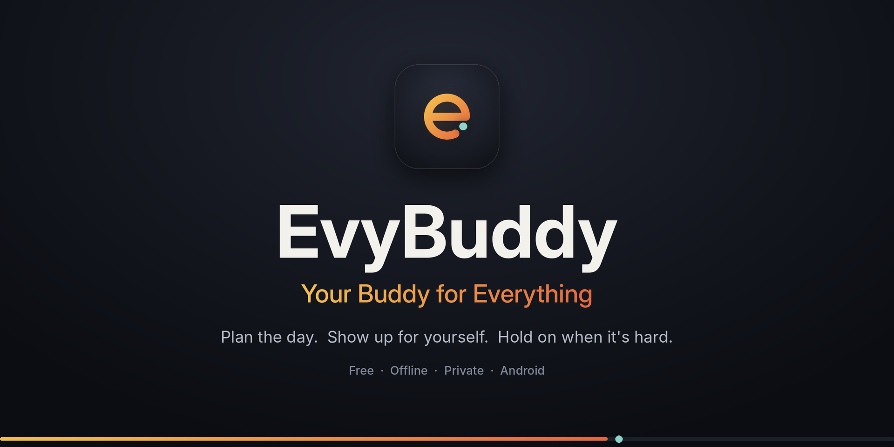

  

  
  
  
  

<h3 align="center">For the days you want to win, and the days you just need to get through.</h3>

---

## You don't need another app. You need a buddy.

Every morning you start again. Some days you wake up ready to take on everything. Some days, just getting out of bed is the win.

**EvyBuddy is there for both.**

It greets you by name and gives you a few honest words to start with. It shows you what today asks of you, nothing more. As you get things done, the bar at the bottom of the screen fills up, and you *see* yourself moving forward.

When things get heavy, when a craving hits, when an old habit calls, when your head gets loud, one tap takes you somewhere calm. A place that's been waiting for you, with no judgement.

## What it brings into your day

### 🌅 A day that makes sense
Your tasks and events, one day at a time. Nothing forgotten, nothing overwhelming. Missed something yesterday? It's gently waiting for you today, not lost and not held against you.

### 💪 Proof that you showed up
Plan your training, then do it. Every session you finish is one more promise kept to yourself. Courage isn't a feeling. It's what you do next.

### 🫶 A safe place for the hard moments
- **Panic button.** Breathe with a guided rhythm and hold on until the ring fills. A craving usually passes within minutes, and you can outlast it.
- **Clean-day counters.** Watch the days add up. A slip doesn't erase them: your best run stays yours.
- **Your own plan for each temptation.** Name what pulls you down, and decide in a calm moment what you'll do in a hard one.
- **Something to do with your hands.** A small block puzzle to keep you busy while the urge fades.
- **Site shield (optional).** Keeps adult sites off your phone when you'd rather not have the choice.
- **Help, always visible.** Emergency services (112) are one tap away.

### 🔁 A Sunday look back
Every Sunday EvyBuddy shows you your week: what you did, how often you showed up, where you held on. Small wins, finally visible.

### ✨ Words that keep you going
A short line under your greeting every day, written for the sport you love. 24 original lines per sport, none borrowed.

### 📱 Always within reach
Home-screen widgets for your day, your progress and a discreet panic button. Reminders that learn when you're usually around, so they show up when they can actually help.

## Yours, and only yours

Your struggles are nobody's business but yours.

- **No account.** Open it and start.
- **No ads, no tracking, no analytics.**
- **Everything stays on your phone.** The only network traffic is the optional site shield checking which sites to block.

## Get EvyBuddy

1. On your Android phone, open the **[latest release](https://github.com/Sl1kSl4k/EvyBuddy/releases/latest)** and download `EvyBuddy-3.0.1.apk`.
2. Open the file. If Android asks, allow your browser or file manager to **install unknown apps**.
3. Tap **Install**, then open EvyBuddy and tell it your name.

Android may show a Play Protect notice because EvyBuddy isn't from the Play Store yet. That's normal for apps shared outside the store. New versions install over the old one and keep everything you've saved.

## A note from me

I built EvyBuddy for myself first: the app I wanted on my own phone. Something that keeps my day in order, reminds me what I'm working towards, and has my back when things get hard.

Now it's free for you. If it helps you take one more step today, it has done its job.

Ideas, bugs or a story to share? [Open an issue](https://github.com/Sl1kSl4k/EvyBuddy/issues). I read every one.

**Bria Raul**, Cluj-Napoca

---

EvyBuddy is a personal tool, not a medical or mental-health service. If you're in danger or in crisis, call 112 or your local emergency number.

Free to download and use; not open source. See [LICENSE](LICENSE). Built with AI-assisted development (Claude, by Anthropic).
